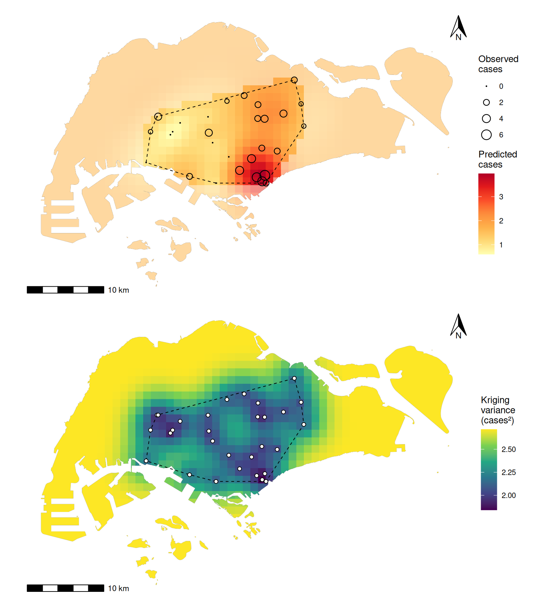

# kriging-incidence

This repository examines how disease case counts vary across Singapore using observations at 30 study sites. It combines spatial interpolation, regression, and facility-location analysis to address three questions: where are counts predicted to be highest, how are counts associated with surrounding green space, and where could two temporary intervention centers be placed to serve the predicted high-count area?

The project is an educational case study developed for a graduate public-health course at the National University of Singapore. The analysis and its assumptions are described below; no course materials are needed to use this repository.

**The analysis entry point is [`run_analysis.R`](run_analysis.R).** It calls the modules in [`R/`](R/). Run it from the repository root with `Rscript run_analysis.R`.

## Data and scientific scope

The supplied dataset contains 30 locations, 56 cases in total, and a green-space percentage for each location. Counts range from zero to six. Each row contains a site identifier, latitude and longitude, projected coordinates, green-space percentage, and case count. Distances are calculated in meters using Singapore's SVY21 coordinate system (EPSG:3414).

The disease, observation period, population at risk, and area represented by each site's count are unspecified. The green-space buffer size and definition are also unspecified. Consequently, the analysis estimates **case counts rather than incidence rates**, despite the repository name. A lower count may reflect fewer people at risk rather than a lower individual disease risk.

Three government spatial datasets provide administrative land boundaries, community-club locations, and train-station exits. Community clubs are considered potential venues for temporary intervention centers. Their addresses and listed accessibility were checked against the official directory; availability for an intervention still requires operator confirmation. Input files, field definitions, dataset links, and dated verification notes are documented in [data/README.md](data/README.md).

## Analysis

1. **Describe the observations and estimate spatial dependence.** An empirical variogram summarizes how squared differences between site counts change with separation distance. Spherical, exponential, and Gaussian models are fitted across 180 combinations of distance-bin width, maximum fitted distance, model family, and fitting weights, each with four starting values. Convergence and parameter stability are checked before models are compared using leave-one-out prediction errors. A pure-nugget model, which assumes no spatial correlation between distinct sites, provides a reference.

2. **Predict counts and identify higher-count areas.** Ordinary kriging uses the selected spatial-dependence model to form weighted predictions on a 1 km grid clipped to the land boundary. Each prediction represents the expected count at a hypothetical site at that location; it does not directly estimate all cases inside the grid square. Higher-count zones are defined by the upper 25% and upper 10% of predictions among squares overlapping the convex hull of the observed sites. The convex hull is the polygon enclosing those sites. Predictions elsewhere are flagged as extrapolation. Kriging variances, rectangular block predictions, and 200 conditional Gaussian simulations assess uncertainty and sensitivity to spatial support.

3. **Examine the green-space association.** Poisson regression relates the observed site counts to green cover, with a quasi-Poisson comparison for overdispersion. The effect is reported as an expected-count ratio per 10-percentage-point increase in green space. Moran's I measures spatial autocorrelation in the counts and regression residuals under two neighborhood definitions. This regression is separate from the primary ordinary-kriging model, which does not use green space as a predictor.

4. **Select two potential intervention centers.** Candidate community clubs must lie within 500 m of a train-station exit and within 1 km of the higher-count zone. Every eligible pair is evaluated. The selected pair minimizes the mean straight-line distance from the zone's grid points to the nearer club, weighted by predicted counts multiplied by each square's land area. Sensitivity analyses repeat the predictions and center selection under alternative spatial models and after removing an influential observation.

Full equations, figures, references, and interpretation are in the [PDF report](reports/report.pdf). The editable [Quarto source](report.qmd) and a [Word version](reports/report.docx) are also included.

## Principal findings

| Finding | Result and interpretation |
|---|---|
| Spatial-dependence model | Selected spherical variogram: nugget 1.47 and partial sill 1.09 cases squared, with a range of 7.05 km. The nugget represents variation unresolved at the observed spatial scale; the partial sill is the spatially correlated component. |
| Predictive performance | Leave-one-out root mean squared error was 1.40 cases, compared with 1.75 for the no-spatial-correlation reference. |
| Higher-count zone | The upper-quarter zone covers about 55.7 square kilometers, extending from Marina Bay toward Hougang. |
| Green-space association | Expected-count ratio 0.73 per 10-percentage-point increase in green cover, with a profile-likelihood 95% confidence interval of 0.59 to 0.89. Positive residual spatial autocorrelation was not detected after this adjustment. |
| Proposed centers | Braddell Heights and Kampong Glam Community Clubs minimize the weighted distance among 496 eligible pairs. The mean distance to the nearer center is 2.14 km. |

The same two centers were selected in the five ordinary-kriging scenarios, including the selected model. The universal-kriging scenario selected Kampong Glam and MacPherson Community Clubs instead. These results describe this dataset and the stated assumptions; they do not establish a transmission mechanism, a protective effect of green space, or the operational suitability of the venues.



The upper panel shows predicted counts at grid points, with extrapolated predictions outside the sample hull faded. The lower panel shows kriging variance in cases squared. The dashed boundary encloses the observed sites; circles mark their locations.

## Limits on interpretation

Thirty sites provide limited information for estimating spatial dependence, and most attempted variogram settings did not yield a stable fit. The variogram is held fixed during leave-one-out cross-validation, and those errors are also used to select the model. The reported performance therefore does not independently validate the complete model-selection procedure.

About 72% of the mapped land area lies outside the sample convex hull. A 1 km display grid does not establish 1 km inferential resolution, and Gaussian kriging is an approximation for sparse integer counts. The conditional simulations describe uncertainty under the fitted model rather than propagating uncertainty in variogram selection.

Converting the predicted surface to a total number of cases requires an assumption about the area represented by each site's count. The report compares illustrative catchment assumptions; these are not measured outbreak totals. The green-space association is ecological and may be confounded by population density, housing, or other features of urban form.

Center placement uses straight-line distances rather than walking routes or public-transport travel times. Venue capacity, opening hours, route accessibility, and operator agreement would need to be established before implementing a service.

## Reproduce the analysis

Use R 4.4.1, the version used for verification, and Python 3 for the table-reproduction check. R package versions are pinned in [`renv.lock`](renv.lock). To render the report, also install Quarto and a LaTeX distribution with XeLaTeX, such as TinyTeX.

On Ubuntu, the spatial packages require these system dependencies:

```sh
sudo apt install gdal-bin libgdal-dev libgeos-dev libproj-dev libudunits2-dev
```

From the repository root, restore the R packages and run the complete analysis and checks:

```sh
Rscript scripts/install_dependencies.R
Rscript run_analysis.R
Rscript tests/check_outputs.R
python3 tests/check_reproduction.py
```

The pipeline uses seed 5105 and takes about one minute in the verified environment. All required data are included, so analysis runs offline after dependency installation. It writes figures, tables, report inputs, and session information to `outputs/`.

To generate PDF and Word reports from those results:

```sh
quarto render report.qmd
```

The documents are written to `reports/`. Computed outputs are already included, so rendering does not require rerunning the analysis. If a LaTeX distribution is missing, `quarto install tinytex` installs one for PDF rendering.

## Verification

[`tests/check_outputs.R`](tests/check_outputs.R) independently verifies 63 scientific results, including all 1,017 kriging predictions and variances, empirical variogram summaries, cross-validation metrics, Poisson confidence limits, spatial statistics, zone totals, and all 496 center-pair scores. These checks recompute results through separate numerical routes rather than merely checking that output files exist.

[`tests/check_reproduction.py`](tests/check_reproduction.py) compares all 14 CSV tables with SHA-256 hashes from the independently checked analysis before its code was reorganized into modules. Both the full modular pipeline and dependency restoration from a clean checkout have been verified. Exact table equality assumes the recorded package versions and numerical environment; different spatial libraries can affect geometry and floating-point results. Verification evidence is recorded in [`outputs/validation.json`](outputs/validation.json).

The manuscript claim audit is reproducible with `Rscript scripts/audit_report_claims.R`. It evaluates every inline report expression and recomputes evidence for catchment scenarios, prediction domains, numerical rankings, simulations, and center sensitivity. [The audit outputs](outputs/audit/) also record the manual claim review and its sources. Numerical agreement does not establish causal attribution, independent predictive accuracy, or venue suitability.

## Code and file organization

| Path | Contents |
|---|---|
| [`run_analysis.R`](run_analysis.R) | Analysis entry point, coordinating the stages through explicit inputs and returned results. |
| [`R/setup.R`](R/setup.R), [`R/data.R`](R/data.R) | Dependencies, paths, output writers, data validation, spatial preparation, and exploration. |
| [`R/variograms.R`](R/variograms.R), [`R/variogram_helpers.R`](R/variogram_helpers.R) | Variogram fitting, stability checks, and model selection. |
| [`R/kriging.R`](R/kriging.R), [`R/zone_helpers.R`](R/zone_helpers.R) | Prediction grid, kriging, zones, block sensitivity, and conditional simulations. |
| [`R/green_space.R`](R/green_space.R) | Count regression and spatial diagnostics. |
| [`R/facilities.R`](R/facilities.R), [`R/facility_helpers.R`](R/facility_helpers.R) | Venue filtering and two-center optimization. |
| [`R/sensitivity.R`](R/sensitivity.R), [`R/sensitivity_helpers.R`](R/sensitivity_helpers.R) | Alternative-model and influential-site analyses. |
| [`R/export.R`](R/export.R) | Saves the numerical results needed by the report. |
| [`data/`](data/), [`outputs/`](outputs/) | Input data and provenance; computed figures, tables, results, and verification records. |
| [`report.qmd`](report.qmd), [`reports/`](reports/), [`references/`](references/) | Report source, rendered documents, bibliography, citation style, and filter. |
| [`tests/`](tests/), [`scripts/`](scripts/), [`renv.lock`](renv.lock) | Scientific checks, dependency restoration, and pinned package versions. |

## Provenance and attribution

The site table was supplied for SPH5105 Individual Assessment 2, a graduate public-health spatial-analysis assessment at the National University of Singapore. The assessment asked for data exploration, variogram fitting, kriging, higher-count zones, a green-space analysis, and two proposed intervention centers.

Contains information from URA's *Master Plan 2019 Subzone Boundary (No Sea)*, the People's Association's *Community Clubs (2024)*, and LTA's *MRT Station Exits*, accessed on October 7, 2026 from [data.gov.sg](https://data.gov.sg), made available under the [Singapore Open Data Licence](https://data.gov.sg/open-data-licence). Dataset identifiers and source limitations are documented in [data/README.md](data/README.md). This project has no official status or agency endorsement.

The Chicago citation style retains its Creative Commons attribution and share-alike notice in [references/chicago-author-date.csl](references/chicago-author-date.csl). No separate license is granted here for the supplied site table, code, or report.

Claude Code (Anthropic) and Codex (OpenAI) assisted with the code and report. The author takes responsibility for the work, as stated in the report's AI declaration.
