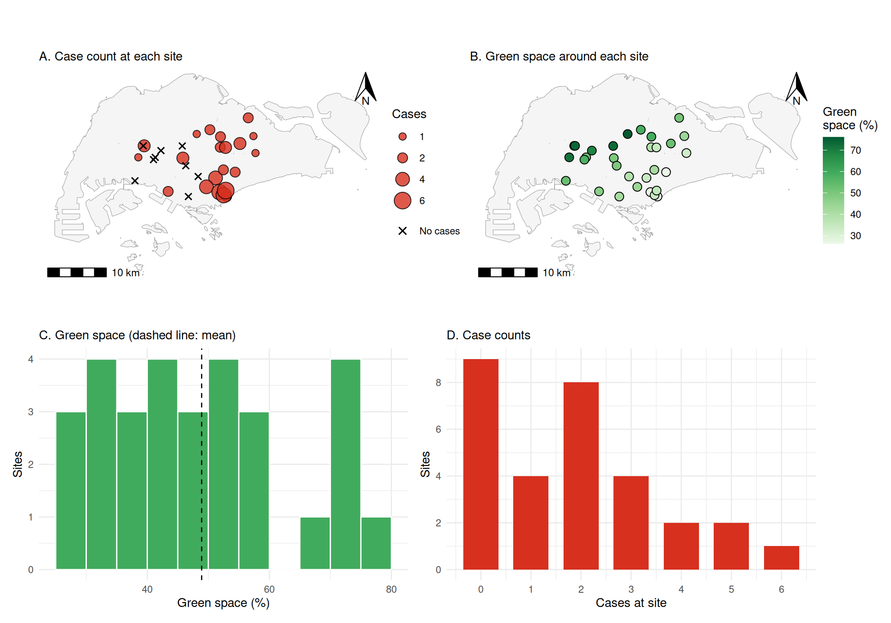
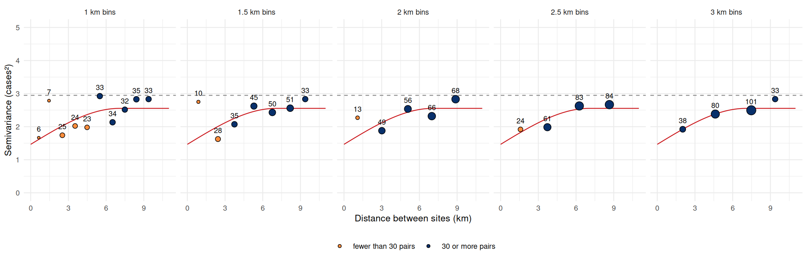
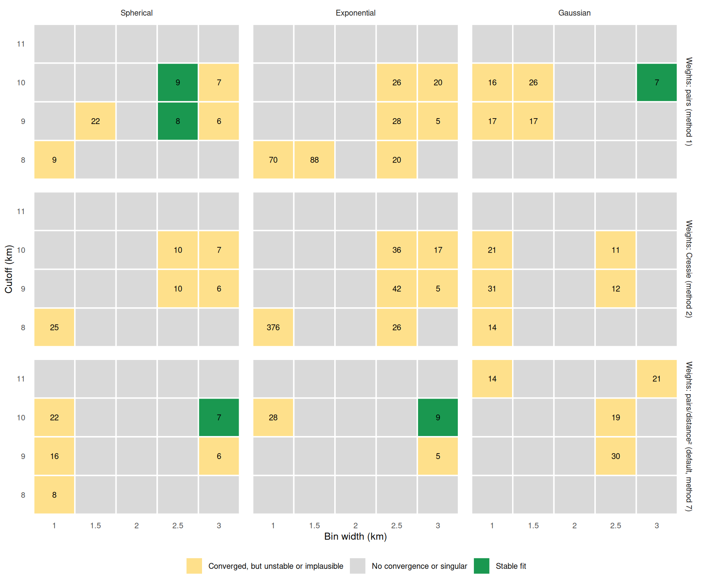
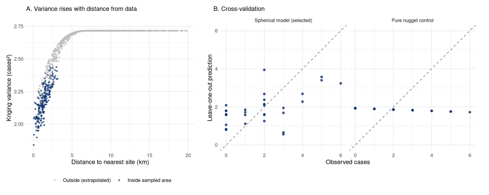
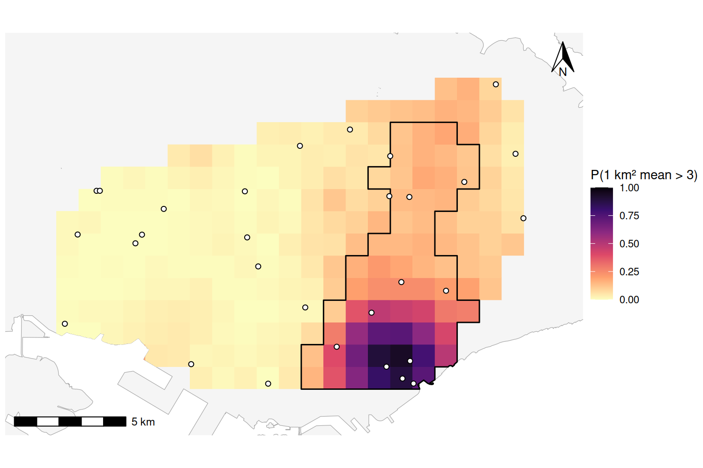
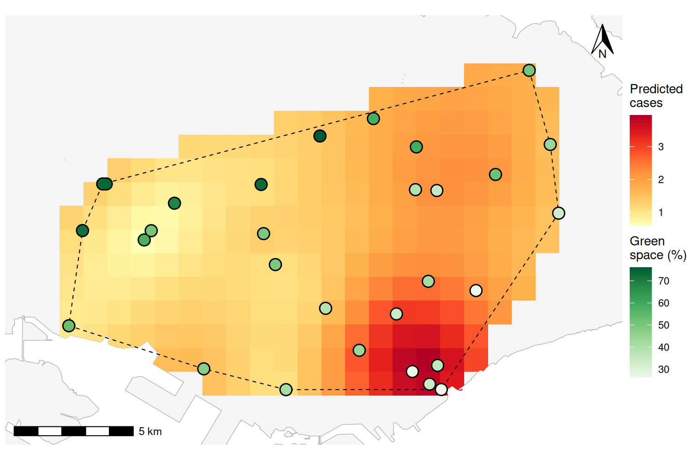
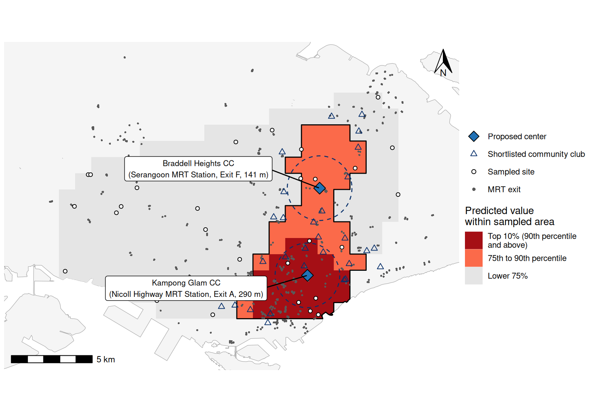

```{r}
#| label: setup
suppressPackageStartupMessages({ library(dplyr); library(knitr) })
r <- readRDS("outputs/results.rds")
grid <- read.csv("outputs/tables/kriging_grid.csv")
f <- function(x, d = 2) formatC(as.numeric(x), digits = d, format = "f", big.mark = ",")
pct <- function(x, d = 0) paste0(formatC(100 * as.numeric(x), digits = d, format = "f"), "%")
pval <- function(p) if (p < 0.001) "< 0.001" else paste("=", f(p, 3))
ptab <- function(p) ifelse(p < 0.001, "<0.001", formatC(p, digits = 3, format = "f"))
sel <- r$selected
nug <- r$vfit$psill[1]; ps <- r$vfit$psill[2]; sill <- nug + ps
rng_km <- r$vfit$range[2] / 1000
z25 <- r$zone_table[1, ]; z10 <- r$zone_table[2, ]
gm <- r$greenspace_model
s <- r$sanity
ex <- r$exceedance
w5 <- r$week5_tests
fs <- r$facility_summary
sens <- r$sensitivity
st <- r$summary_stats
sp <- r$spacing
cands <- r$candidates
model_names <- c(Sph = "Spherical", Exp = "Exponential", Gau = "Gaussian")
short_weights <- c("1" = "N", "2" = "Cressie", "7" = "N/h²")
# Text below describes these two clubs by name; stop if the analysis chose others.
stopifnot(setequal(r$centers$name, c("Braddell Heights CC", "Kampong Glam CC")))
bh <- r$centers[r$centers$name == "Braddell Heights CC", ]
kg <- r$centers[r$centers$name == "Kampong Glam CC", ]
rk <- r$pair_ranking
gap_m <- function(i) f((rk$mean_km[i] - rk$mean_km[1]) * 1000, 0)
in_hull <- grid[grid$in_hull, ]
rest <- in_hull[in_hull$risk_class == "Other", ]
rest_mean <- weighted.mean(rest$pred, rest$land_km2)
catch <- s$hull_land_km2_per_site
p3_max <- max(grid$p_exceed3, na.rm = TRUE)
core_p3 <- mean(grid$p_exceed3[grid$risk_class == "Top 10%"] > 0.5)
stable_n <- sum(r$tuning$stable)
failed_n <- sum(r$tuning$status == "No convergence or singular")
unstable_n <- sum(r$tuning$status == "Converged, but unstable or implausible")
fail_2km <- r$tuning |> filter(width == 2000, cutoff == 10000, method == 7, model == "Sph")
starts_sel <- r$fits |> filter(width == sel$width, cutoff == sel$cutoff, method == sel$method,
                               model == sel$model)
pairs_3km <- sum(dist(r$sites[, c("x", "y")]) <= 3000)
sph_25 <- cands |> filter(model == "Sph", width == 2500, method == 1)
same_bins <- cands |> filter(width == sel$width, cutoff == sel$cutoff, model != sel$model)
no25 <- sens[grepl("site 25", sens$scenario), ]
uk <- sens[grepl("Universal", sens$scenario), ]
kriging_scen <- sens[!grepl("Universal", sens$scenario), ]
and_list <- function(x) {
  x <- strsplit(x, ", ")[[1]]
  paste(paste(head(x, -1), collapse = ", "), "and", tail(x, 1))
}
zone_ids <- as.integer(strsplit(z25$site_ids, ", ")[[1]])
zone_green <- r$sites$green_space[r$sites$id %in% zone_ids]
rel_25 <- z25$est_per_km2 / rest_mean
rel_10 <- z10$est_per_km2 / rest_mean
```

# Abstract {.unnumbered}

Thirty sites in central Singapore reported disease case counts (0 to 6; 56 in total) and the percentage of surrounding green cover. Of 180 variogram settings searched, `r stable_n` met the specified stability criteria. With 3 km lag bins (the narrowest tested width with at least 30 pairs per bin) and a 10 km cutoff, a spherical model (nugget `r f(nug)`, partial sill `r f(ps)` cases^2^, range `r f(rng_km, 1)` km) gave a lower leave-one-out RMSE, from `r f(r$control_cv$rmse)` (pure nugget) to `r f(sel$rmse)` cases, with a z-score SD near one (`r f(sel$z_sd)`). The variogram was held fixed during validation, and the same errors were used for model selection, so this comparison may be optimistic.

Ordinary kriging on `r f(s$n_cells, 0)` nominal 1 km^2^ land squares identified one contiguous top-quartile zone of `r f(z25$area_km2, 1)` km^2^ from Marina Bay to Hougang, with `r f(rel_25, 1)` times the predicted intensity of the rest of the sampled area. Its absolute density depends on the unknown area each count represents: `r f(z25$est_per_km2, 1)` cases per km^2^ for a 1 km^2^ catchment, `r f(z25$est_per_km2 / catch, 1)` for a `r f(catch, 1)` km^2^ catchment (sampled land per site). Each 10 percentage points of green cover was associated with `r pct(1 - gm$ratio)` fewer expected cases (count ratio `r f(gm$ratio)`, 95% CI `r f(gm$ratio_ci[1])` to `r f(gm$ratio_ci[2])`), and positive residual spatial autocorrelation was not detected after adjustment for green space. Braddell Heights and Kampong Glam Community Clubs, both inside the zone and within 300 m straight-line distance of an MRT exit, are proposed as intervention centers; the choice did not change under alternative variogram models. Most of the island is unsampled, and without population denominators the results describe counts, not risk per person.

# Introduction {#sec-intro}

Kriging predicts a spatially continuous quantity at unsampled locations from nearby observations, weighting each observation according to a model of how similarity between locations declines with distance [@matheron1963; @cressie1993]. This report applies it to counts of an unnamed illness recorded at 30 sites in Singapore, together with the percentage of green cover around each site. The aims were (i) to estimate and justify a model of the spatial dependence of the counts; (ii) to map predicted counts on a 1 km grid and delineate high-risk zones; (iii) to assess whether green cover is associated with the counts and whether residual spatial autocorrelation remains after adjustment; and (iv) to quantify outbreak size in the high-risk zones and propose two accessible temporary intervention centers. @sec-methods describes the methods, @sec-data to @sec-outbreak report the results in the order of these aims, and @sec-discussion discusses their limitations.

# Methods {#sec-methods}

## Data and preprocessing {#sec-m-data}

Each of the 30 sites has an identifier, WGS84 latitude and longitude, projected coordinates (`x`, `y`) in meters, the percentage of green cover around the site and a count of cases. The table was transcribed to CSV, checked cell by cell against the source document, and converted to a simple features point object [@pebesma2018] in the SVY21 / Singapore TM projected coordinate reference system (EPSG:3414):

```{r}
#| echo: true
#| eval: false
sites <- read.csv("../data/raw/assignment2.csv")
obs <- sf::st_as_sf(sites, coords = c("x", "y"), crs = 3414, remove = FALSE)
```

Geostatistical methods depend on distances between locations, and a degree of longitude is not a fixed distance, so all distance-based steps used the projected coordinates in meters. To confirm that both coordinate sets describe the same points, the latitudes and longitudes were reprojected to EPSG:3414 and compared with `x` and `y`.

Three external layers were obtained from data.gov.sg and projected to EPSG:3414: the Urban Redevelopment Authority Master Plan 2019 subzone boundary without sea, dissolved into a land outline [@ura2019]; People's Association community clubs [@pa2024]; and Land Transport Authority MRT station exits [@lta2026]. The prediction grid consisted of 1 km × 1 km squares aligned to whole kilometers of the SVY21 grid and clipped to the land outline. Each square was represented by its center, or by a point inside its land portion where the center fell in the sea, and its land area was kept for area-based calculations. Squares overlapping the convex hull of the sites (the smallest convex polygon that contains them) defined the domain used for zone analysis, termed the sampled area below. This includes entire land portions of boundary squares, whose prediction points can fall outside the hull. Hull membership is a geometric convention and does not establish predictive reliability.

## The empirical variogram {#sec-m-vario}

Kriging requires a model of spatial dependence, that is, of how much more alike two counts are when their sites are close together than when they are far apart. The variogram expresses this as a function of the separation distance, or lag, *h*. For a single pair of sites, the semivariance is half the squared difference between their counts. If nearby sites have similar counts, semivariance is small at short lags and increases with lag until sites are far enough apart to be unrelated, where it levels off at the variance of the process [@matheron1963; @oliver2014].

Irregularly spaced sites are rarely separated by exactly the same distance, so pairs are grouped into distance intervals called lag bins. The empirical variogram is the mean semivariance in each bin [@matheron1963]:

$$\hat\gamma(h) = \frac{1}{2N(h)} \sum_{(i,j) \in P_h} \left(z(s_i) - z(s_j)\right)^2 ,$$

where $P_h$ contains the unordered pairs $(i,j)$, with $i < j$, whose Euclidean separation $\|s_i-s_j\|$ falls in the bin around lag *h*, $N(h)=|P_h|$, and $z(s_i)$ is the count at site $s_i$. Semivariance has units of cases^2^. Two analyst choices define the bins. The bin width sets how finely distance is resolved: narrow bins show the behavior at short lags, which has the most influence on kriging, but each mean rests on few pairs and is noisy, whereas wide bins are stable but blur short-range structure. The cutoff is the largest lag included. Long lags are represented by few pairs, mostly between sites at opposite edges of the study area, and estimate the variogram poorly. Journel and Huijbregts [-@journel1978, 194], as quoted by @cressie1985, recommend using only lags with more than 30 pairs and only up to about half the largest lag. Following @dickens2026, the rule was applied by choosing the narrowest bin width for which every bin up to the cutoff holds at least 30 pairs. It is a heuristic that trades resolution at short lags against noise in bins with few pairs. Empirical variograms were computed with `gstat::variogram` for bin widths of 1, 1.5, 2, 2.5 and 3 km and cutoffs of 8, 9, 10 and 11 km.

## Variogram models and their parameters {#sec-m-models}

The empirical variogram is known only at the bin lags, whereas kriging needs the semivariance at every distance, between each site and the prediction location and between every pair of sites. A continuous model is therefore fitted to the empirical points. Only certain functions are valid, because the model must guarantee a non-negative kriging variance [@cressie1993]. Each model used here has three parameters (@fig-models). The nugget ($c_0$) is the semivariance just above zero lag; it represents measurement error and variation over distances shorter than the closest spacing of sites. Because the semivariance at exactly zero lag is zero by definition, the nugget appears as a jump at the origin. The sill ($c_0 + c_1$) is the plateau reached by sites that are unrelated, equal to the variance of the process, and the partial sill ($c_1$) is the spatially structured part of that variance. The range is the lag at which the sill is reached, beyond which the modeled covariance is zero; for models that approach the sill asymptotically, the practical range is the lag at which about 95% of the partial sill is reached. The nugget-to-sill ratio was described using the soil-variability classification of @cambardella1994: strong below 0.25, moderate from 0.25 to 0.75 and weak above 0.75. This is a descriptive convention, not a test of predictive reliability.

```{r}
#| label: fig-models
#| fig-cap: "The three variogram model families, drawn with the nugget, partial sill and practical range of the selected model (@sec-parameters). The open circle marks $\\gamma(0) = 0$; the nugget is the jump just above zero lag."
#| fig-width: 6.5
#| fig-height: 3.2
#| out-width: 88%
#| dpi: 300
suppressPackageStartupMessages(library(ggplot2))
fam_cols <- c(Spherical = "#cb181d", Exponential = "#fd8d3c", Gaussian = "#6a51a3")
fam_fun <- list(
  Spherical   = function(h) ifelse(h <= rng_km, nug + ps * (1.5 * h / rng_km - 0.5 * (h / rng_km)^3), sill),
  Exponential = function(h) nug + ps * (1 - exp(-3 * h / rng_km)),            # a = practical range / 3
  Gaussian    = function(h) nug + ps * (1 - exp(-3 * (h / rng_km)^2)))       # a = practical range / sqrt(3)
h_km <- seq(0.01, 12, length.out = 600)
curves <- bind_rows(lapply(names(fam_fun), function(m) tibble(model = m, h = h_km, gamma = fam_fun[[m]](h_km))))
curves$model <- factor(curves$model, levels = names(fam_cols))
ggplot(curves, aes(h, gamma, color = model, linetype = model)) +
  geom_hline(yintercept = sill, color = "grey45", linetype = "dashed", linewidth = 0.4) +
  geom_vline(xintercept = rng_km, color = "grey45", linetype = "dotted", linewidth = 0.5) +
  geom_line(linewidth = 0.8) +
  annotate("point", x = 0, y = 0, shape = 21, size = 2.2, fill = "white", color = "grey20") +
  annotate("segment", x = -0.45, xend = -0.45, y = 0.03, yend = nug - 0.03, color = "grey20",
           arrow = arrow(ends = "both", length = unit(0.06, "inches"))) +
  annotate("segment", x = -0.45, xend = -0.45, y = nug + 0.03, yend = sill - 0.03, color = "grey20",
           arrow = arrow(ends = "both", length = unit(0.06, "inches"))) +
  annotate("text", x = -0.6, y = nug / 2, label = paste0("Nugget\n", f(nug)), hjust = 1, size = 3) +
  annotate("text", x = -0.6, y = (nug + sill) / 2, label = paste0("Partial sill\n", f(ps)), hjust = 1, size = 3) +
  annotate("text", x = 11.9, y = sill + 0.12, label = paste0("Sill ", f(sill)), hjust = 1, size = 3,
           color = "grey25") +
  annotate("text", x = rng_km + 0.15, y = 0.35, label = paste0("Practical range\n", f(rng_km, 1), " km"),
           hjust = 0, size = 3, color = "grey25") +
  scale_color_manual(values = fam_cols, name = NULL) +
  scale_linetype_manual(values = c(Spherical = "solid", Exponential = "longdash", Gaussian = "dotdash"),
                        name = NULL) +
  scale_x_continuous(breaks = seq(0, 12, 2), expand = expansion(mult = c(0, 0.01))) +
  scale_y_continuous(breaks = seq(0, 3, 0.5), expand = expansion(mult = c(0, 0.04))) +
  coord_cartesian(xlim = c(-2.6, 12), ylim = c(0, 2.9), clip = "off") +
  labs(x = "Lag distance h (km)", y = "Semivariance (cases²)") +
  theme_minimal(base_size = 10) +
  theme(legend.position = "inside", legend.position.inside = c(0.84, 0.36),
        legend.key.width = unit(0.9, "cm"), legend.background = element_rect(fill = "white", color = NA),
        panel.grid.minor = element_blank(),
        axis.text.y = element_text(margin = margin(r = 2)))
```

| Model | $\gamma(h)$ for $h > 0$ | Near the origin | Practical range | Implied surface |
|:--|:--|:--|:--|:--|
| Spherical | $c_0 + c_1\left[\tfrac{3}{2}\tfrac{h}{a} - \tfrac{1}{2}\left(\tfrac{h}{a}\right)^3\right]$ for $h \le a$; $c_0 + c_1$ for $h > a$ | Linear | $a$ | Patches of finite size |
| Exponential | $c_0 + c_1\left[1 - e^{-h/a}\right]$ | Linear, steeper | $\approx 3a$ | Irregular (rough) |
| Gaussian | $c_0 + c_1\left[1 - e^{-(h/a)^2}\right]$ | Parabolic | $\approx \sqrt{3}\,a$ | Very smooth |

: Variogram model families. $c_0$: nugget; $c_1$: partial sill; $a$: range parameter as defined in gstat. {#tbl-models tbl-colwidths="[13,43,14,13,17]"}

The three families differ in how quickly similarity is lost with distance (@tbl-models, @fig-models). The spherical model rises almost linearly and reaches the sill exactly at the range, so sites farther apart than that have zero modeled covariance; it suits processes organized in patches of a characteristic size. For the same practical range, the exponential model rises twice as steeply at the origin and then approaches the sill only gradually, so similarity is lost quickly at short distances but never vanishes completely; it suits processes that vary irregularly from place to place. The Gaussian model is flat near the origin and then rises steeply, which implies a very smooth spatially structured component; a nugget still allows abrupt local variation. It suits smoothly varying quantities such as elevation and can make the kriging equations numerically unstable without a nugget [@oliver2014; @dickens2026]. In gstat the range parameter equals the practical range only for the spherical model, so practical ranges are reported throughout.

## Model fitting and convergence {#sec-m-fit}

Models were fitted with `gstat::fit.variogram` [@pebesma2004; @graler2016], which minimizes the weighted sum of squared differences between the empirical and model semivariances, $\sum_j w_j \left(\hat\gamma(h_j) - \gamma(h_j; \theta)\right)^2$, over the parameters $\theta = (c_0, c_1, a)$. Because the models are nonlinear in the range, the fit is computed iteratively from user-supplied starting values, stopping when the relative change in the weighted residual sum of squares falls below a tolerance. In gstat 2.1-6, weights are held fixed during a fit; method 2 uses the starting variogram to compute its model-dependent weights. Three weighting schemes were compared: $w_j = N_j$, which trusts bins with more pairs (gstat method 1); $w_j = N_j/\gamma_{\mathrm{start}}(h_j)^2$, which down-weights bins with high starting-model semivariance (gstat method 2) [@cressie1985]; and $w_j = N_j/h_j^2$, which emphasizes short lags in fitting the variogram (method 7, the gstat default) [@gstatmanual].

An iterative fit is reported as converged when its stopping criterion is met; this alone does not establish a global minimum. It can fail in two ways. It may reach the iteration limit without settling, which gstat reports with a warning ("No convergence after 200 iterations"), or the parameters may not be separable from one another, for example when a spherical range falls below the first lag: every modeled bin is at the sill, so the nugget and partial sill cannot be separated and the range is unidentified, which gstat flags as a singular fit. In both cases gstat still returns parameter values, so the absence of an error does not imply a valid fit. With few bins, a fit can also converge to different solutions from different starting values. Each combination of bin width, cutoff, model family and weighting (180 settings) was therefore fitted from four starting values: one read from the empirical variogram (nugget 1.5 and partial sill 1.5 cases^2^, practical range 6 km) and three deliberately poor ones (practical range 0.6 km, practical range 60 km, and a nugget close to the full sill). A setting was classed as stable if (i) the sensible start converged without a warning or a singular fit; (ii) at least two starts converged and agreed within 1%; (iii) the parameters were plausible, with a positive partial sill, a practical range no longer than the cutoff (an analyst constraint against extrapolating the range beyond the fitted lags) and a sill at most twice the sample variance; and (iv) there were more bins than parameters.

## Model selection by cross-validation {#sec-m-cv}

Stable fits were compared by leave-one-out cross-validation with `gstat::krige.cv`. Each site is removed in turn and its count is predicted by ordinary kriging from the other 29 sites, using the variogram fitted to all 30. From the observed counts $z_i$, the cross-validated predictions $\hat z_{-i}$ and their kriging standard deviations $\hat\sigma_{-i}$,

$$\text{RMSE} = \sqrt{\frac{1}{n}\sum_{i=1}^{n} \left(z_i - \hat z_{-i}\right)^2}, \qquad \text{MAE} = \frac{1}{n}\sum_{i=1}^{n} \left|z_i - \hat z_{-i}\right|, \qquad r_i = \frac{z_i - \hat z_{-i}}{\hat\sigma_{-i}} .$$

The root mean squared error (RMSE) and mean absolute error (MAE) measure accuracy in cases; RMSE gives more weight to large errors. The standardized errors (z-scores) $r_i$ provide a diagnostic comparison of prediction errors and modeled uncertainty. A mean near 0 and an SD near 1 are broadly consistent with calibration; an SD above or below 1 suggests uncertainty may be understated or overstated, respectively. With 30 dependent validation errors and a variogram fitted to all sites, these summaries do not establish calibrated intervals [@oliver2014]. The comparator was a pure-nugget model, which assumes no spatial correlation and therefore predicts every site by the mean of the others; lower error than this control was required by the selection rule [@dickens2026]. The selection rule, fixed before any mapping, was the lowest RMSE among stable fits whose bins all hold at least 30 pairs, provided the z-score SD was greater than 0.8 and less than 1.2 and the RMSE was below that of the control. Moran's I (@sec-m-green) of the cross-validation errors tested for remaining positive spatial autocorrelation. The variogram was not refitted within each fold, and these same errors were used to select the setting. The reported accuracy may therefore be optimistic and does not validate the full model-selection procedure.

## Kriging {#sec-m-kriging}

Kriging predicts the count at an unsampled location $s_0$ as a weighted average of the observations, $\hat z(s_0) = \sum_i \lambda_i z(s_i)$, with weights chosen to minimize the expected squared prediction error (the kriging variance) subject to unbiasedness; it is therefore the best linear unbiased predictor under the assumed mean and variogram [@cressie1993]. For ordinary kriging the weights solve

$$
\begin{aligned}
\sum_{j=1}^{n} \lambda_j \gamma(h_{ij}) + \psi &= \gamma(h_{i0}) \quad (i = 1, \dots, n), \\
\sum_{j=1}^{n} \lambda_j &= 1, \\
\sigma^2(s_0) &= \sum_{i=1}^{n} \lambda_i \gamma(h_{i0}) + \psi .
\end{aligned}
$$

where $h_{ij}=\|s_i-s_j\|$ and $h_{i0}=\|s_i-s_0\|$ are Euclidean distances, $\psi$ is a Lagrange multiplier and $\sigma^2(s_0)$ is the kriging variance [@oliver2014]. The weights depend on the distances from $s_0$ to each site and on the distances among the sites. Nearby sites generally receive more weight, and clustered sites share weight because they carry overlapping information, which distinguishes kriging from inverse distance weighting. For a fixed variogram, the kriging variance depends on the observation and prediction locations rather than directly on the observed counts. The fitted variogram itself depends on those counts. The variance generally increases away from the sites but excludes uncertainty from estimating the variogram parameters [@zimmerman1992]. Weights can be negative and need not decrease strictly with distance. With a nugget, the prediction at a sampled site equals the observation, but the variance at any unsampled location is at least the nugget.

Applied to this study, kriging turns the fitted variogram into a predicted count for every grid square in four steps. First, the fitted model converts each distance into a semivariance, both between every pair of the 30 sites (the left side of the system) and between each site and the square's prediction point (the right side). Second, the system is solved for that square, giving 30 weights that sum to one. Third, the prediction is the weighted sum of the 30 observed counts, and the kriging variance follows from the same solution. Fourth, the calculation is repeated for each of the `r f(s$n_cells, 0)` squares; only the right side changes from one square to the next. @tbl-weights shows the result for three squares, computed directly from the equations above; it reproduces the gstat output.

```{r}
#| label: tbl-weights
#| tbl-colwidths: [23, 12, 43, 11, 11]
#| tbl-cap: "Ordinary kriging worked through for three grid squares with the selected spherical model: the five largest weights (site id, observed cases, weight), the prediction and the kriging variance. Weights over all 30 sites sum to one."
stopifnot(as.character(r$vfit$model[2]) == "Sph")
a_m <- r$vfit$range[2]
gam <- function(h) ifelse(h == 0, 0, ifelse(h <= a_m, nug + ps * (1.5 * h / a_m - 0.5 * (h / a_m)^3), sill))
site_xy <- as.matrix(r$sites[, c("x", "y")])
G <- rbind(cbind(gam(as.matrix(dist(site_xy))), 1), c(rep(1, nrow(site_xy)), 0))
ok_square <- function(cell) {
  g0 <- gam(sqrt((site_xy[, 1] - cell$px)^2 + (site_xy[, 2] - cell$py)^2))
  sol <- solve(G, c(g0, 1))
  w <- sol[seq_len(nrow(site_xy))]
  list(w = w, pred = sum(w * r$sites$cases), var = sum(w * g0) + sol[length(sol)])
}
ex_cells <- list("Marina East (highest prediction)" = in_hull[which.max(in_hull$pred), ],
                 "Bukit Batok (lowest in sampled area)" = in_hull[which.min(in_hull$pred), ],
                 "North-Eastern Islands (outside sampled area)" = grid[which.max(grid$nearest_site_km), ])
bind_rows(lapply(names(ex_cells), function(nm) {
  cell <- ex_cells[[nm]]; k <- ok_square(cell)
  stopifnot(all(is.finite(k$w)), abs(sum(k$w) - 1) < 1e-10,
            abs(k$pred - cell$pred) < 1e-6, abs(k$var - cell$var) < 1e-6)  # agrees with gstat
  o <- order(-k$w)[1:5]
  tibble(Square = nm, `Nearest (km)` = f(cell$nearest_site_km, 1),
         `Five largest weights: site (cases): weight` =
           paste(sprintf("%d (%d): %.2f", r$sites$id[o], r$sites$cases[o], k$w[o]), collapse = "; "),
         `Predicted count` = f(k$pred), Variance = f(k$var))
})) |> kable(align = "lrlrr")
```

At the Marina East square most of the weight falls on the high-count Marina Bay sites within a few kilometers, so the prediction is high. Around Bukit Batok the nearest sites reported few cases, so it is low. At the North-Eastern Islands, about 20 km from the nearest site, no site lies within the range; the weights are distributed across all sites and the prediction equals the estimated constant mean, with the largest variance. These weights account for correlation among the sites, so this mean differs from the unweighted sample mean. A kriged value is therefore the count expected at a hypothetical additional site at that point, recorded in the same way and over the same period as the observed counts. It is not the number of cases inside the square; converting it to cases per km^2^ requires an assumption about the area that each count represents (@sec-m-zones).

| Method | Baseline expected cases per site | Unknown mean parameters | Use in this report |
|:--|:--|:--|:--|
| Simple kriging | A value supplied and treated as known | None for the supplied mean | Not used |
| Ordinary kriging | One constant baseline across locations | The constant $\mu$, an intercept | Primary analysis |
| Universal kriging | A baseline that varies with a specified trend | Intercept and trend coefficients | Sensitivity analysis (linear trend in `x` and `y`) |
| Block kriging | Uses the chosen ordinary or universal mean structure; predicts an area average of the cases-per-site field | Same mean parameters as the corresponding point model | Check of zone totals |

: Kriging variants for the cases-per-site field. Block kriging changes the prediction support rather than specifying a separate mean model [@goovaerts1997; @dickens2026]. {#tbl-kriging-types tbl-colwidths="[18,35,24,23]"}

Here, the mean is the baseline expected number of cases recorded per site, assuming a common observation protocol and period. It is denoted $\mu$ when constant, or $m(s)$ when it varies with location. A mean of 2 cases per site allows individual counts of 0, 3 or 6; an expected count need not be an integer. This mean is separate from the nugget, partial sill and range, which describe variation and spatial dependence.

Simple kriging supplies the expected count beforehand and treats it as known. Ordinary kriging assumes one constant baseline but does not supply its value. Its unknown mean parameter is the intercept $\mu$; in `cases ~ 1`, the `1` specifies an intercept-only mean structure. The observations inform its estimation, accounting for their spatial covariance, so the estimated baseline can differ from the arithmetic average of the 30 counts. Requiring the weights to sum to one makes the predictor unbiased for any value of $\mu$ under the constant-mean assumption [@cressie1993; @zimmerman1992].

A constant baseline does not require constant predictions. After conditioning on the observed counts, spatial correlation allows nearby high or low counts to raise or lower the prediction at an unsampled site relative to that baseline.

Universal kriging allows the baseline expected count to follow a specified trend, for example $m(s)=\beta_0+\beta_x x(s)+\beta_y y(s)$. The intercept and slopes are unknown parameters, while the coordinates must be available at observation and prediction locations. Kriging with external drift uses measured covariates, such as green cover, to describe that changing baseline. It requires covariate values at prediction locations, which are unavailable here for green space. The separate Poisson regression therefore does not change the primary kriging mean model (@tbl-kriging-types). Ordinary kriging with all 30 sites (formula `cases ~ 1`) was the primary method:

```{r}
#| echo: true
#| eval: false
v    <- gstat::variogram(cases ~ 1, obs, width = 3000, cutoff = 10000)
vfit <- gstat::fit.variogram(v, gstat::vgm(psill = 1.5, model = "Sph", range = 6000, nugget = 1.5))
ok   <- gstat::krige(cases ~ 1, obs, newdata = cell_pts, model = vfit)
```

Kriging predictions refer to points. Block kriging instead predicts the average of the modeled cases-per-site field over an area, retaining the units of cases per site. This is not automatically the total number of cases inside that area; conversion requires a catchment assumption (@sec-m-zones). An average over a 1 km square (block support) has less variability than a point value because averaging reduces variation at short distances, including the nugget. Its prediction averages the conditional surface over the square and need not equal the prediction at its center. Block kriging was used as a sensitivity check on zone totals, using full 1 km rectangles centered on the zone prediction points; these rectangles were not clipped to irregular coastal land portions. Kriging predictions smooth variation relative to realizations of the fitted process and can suppress extreme values and threshold exceedance. This does not imply that every high value is underpredicted or that every threshold area is underestimated [@dickens2026]. To quantify this, 200 conditional simulations were drawn by sequential Gaussian simulation [@goovaerts1997]. The algorithm visits the prediction points in random order, kriges each from the data and the previously simulated points (here the 30 nearest), draws a value from a normal distribution with the kriging mean and variance, and adds it to the conditioning data. These are approximate Gaussian realizations conditional on the observations and the fixed fitted variogram, using a local neighborhood. Individual realizations need not reproduce the empirical variogram exactly, and the simulations do not propagate variogram-parameter uncertainty. Each square was simulated at a 4 × 4 lattice of land points, together with its prediction point; their mean approximates the average over the square's land portion. The main kriged map retains point support.

## High-risk zones and outbreak size {#sec-m-zones}

Here, high risk denotes higher predicted counts under the model, not higher incidence per person. High-risk squares were those in the sampled area with predictions at or above the 75th percentile (top 25%) of predictions in that area, and the core those at or above the 90th percentile (top 10%). Restricting the percentiles to hull-overlapping squares excludes the more distant cells from setting the thresholds, although boundary squares can include prediction points outside the hull. The data do not state the catchment of each count, that is, the area whose cases the count records. Expressing outbreak size in cases per km^2^ therefore requires an assumption, and two illustrative scenarios were used. Under the first, each count reflects about 1 km^2^ around its site, the size of a grid square; each prediction is then an expected number of cases per km^2^, and the expected number of cases in a zone is the sum over its squares of prediction × land area. Under the second, the 30 sites share the sampled region equally. The land inside the convex hull of the sites covers `r f(catch * 30, 1)` km^2^, or `r f(catch, 1)` km^2^ per site, so each count is spread over `r f(catch, 1)` km^2^ and all totals and densities are divided by `r f(catch, 1)`. These are simple rescaling scenarios, not a change-of-support model fitted to measured catchments, and they do not bound true outbreak size. The true catchment is unknown and could be smaller or larger than either value. Because the assumption rescales every square by the same factor, it changes totals and densities but not the ranking of squares, the zones, relative intensities against the lower 75% of the sampled area, or the choice of centers.

## Association with green space {#sec-m-green}

The association between green space and counts was estimated at the 30 sites, not on the kriged grid, whose values are smoothed functions of the same 30 counts. Spearman's rank correlation gave a distribution-free summary. Counts were modeled by Poisson regression with a log link, $\log E(Y_i) = \beta_0 + \beta_1 x_i$, with green cover $x_i$ per 10 percentage points, so that $e^{\beta_1}$ is the ratio of expected counts for a 10-point increase. No offset was included because neither population nor observation time was available, so the ratio compares expected counts, not incidence rates [@dickens2026b]. Its 95% confidence interval was obtained from the profile likelihood and its p-value from a likelihood ratio test. Overdispersion was assessed by the Pearson statistic divided by the residual degrees of freedom, with a quasi-Poisson fit as a check.

Adjustment for green space means predicting each site's expected count from its green cover, then examining the differences between observed and predicted counts. The Pearson residual is $r_i = (Y_i - \hat\mu_i)/\sqrt{\hat\mu_i}$, where $\hat\mu_i$ is the fitted expected count. A positive residual means more cases than predicted given that site's green space; a negative residual means fewer. Residual Moran's I asks whether neighboring sites share these unexpected excesses or deficits. Weaker residual autocorrelation is consistent with green space capturing part of the geographic pattern in the counts. The observed counts remain unchanged. This adjustment is a separate regression analysis; green space is not a covariate in the primary ordinary-kriging model.

Spatial autocorrelation before and after this adjustment was compared using Moran's I [@moran1950],

$$I = \frac{n}{\sum_{i}\sum_{j} w_{ij}} \, \frac{\sum_{i}\sum_{j} w_{ij}(z_i - \bar z)(z_j - \bar z)}{\sum_{i} (z_i - \bar z)^2} ,$$

where $w_{ij}$ is the neighbor weight between sites *i* and *j*. *I* is positive when neighboring sites have similar values, negative when they differ, and close to its expectation of $-1/(n-1)$ under no autocorrelation. It was computed for the counts and for the Pearson residuals of the Poisson model, with one-sided p-values for positive autocorrelation from 9,999 random permutations [@bivand2018], under two row-standardized neighbor definitions: the four nearest neighbors of each site (made symmetric), and a distance band set 0.1% above the largest nearest-neighbor distance to avoid isolated sites. Following @dickens2026b, a linear regression of counts on green space was also tested with one-sided Moran's I of its residuals and with the robust Lagrange multiplier tests, which distinguish spatial dependence in the errors from dependence in the outcome [@anselin1996]. Permuting fitted Poisson residuals is an exploratory diagnostic because the residuals are estimated from the same data.

## Locating the intervention centers {#sec-m-centers}

Temporary intervention centers are short-term facilities from which an outbreak response is delivered to the affected population, for example testing, treatment, health information and the coordination of environmental control. A good location is one that people in the high-risk zone can reach easily, so the selection combined accessibility criteria with the kriged surface. Candidate venues were community clubs [@pa2024], which are public, staffed buildings with halls located within housing estates. Clubs flagged in the 2024 dataset as under construction or pending upgrading or relocation were checked against the current official directory [@onepa2026]. Accessibility was defined as lying within 500 m (straight line) of an MRT station exit [@lta2026], and proximity as lying within 1 km of the top-25% zone. The kriged surface supplies the demand: each square of the top-25% zone is weighted by its estimated number of cases (prediction × land area), so squares with more expected cases pull the centers toward them. From the clubs meeting both criteria, two centers were chosen by solving the two-facility p-median problem [@hakimi1965], that is, by finding the pair of clubs $S$ that minimizes the case-weighted mean distance from the zone's squares to the nearer center,

$$\frac{\sum_k w_k \min_{j \in S} d_{kj}}{\sum_k w_k} ,$$

where *k* indexes the squares of the zone, $w_k$ is the estimated number of cases in square *k* and $d_{kj}$ is the straight-line distance from square *k* to club *j*. Every pair was evaluated, so the solution is optimal within the candidate set. Because the catchment assumptions of @sec-m-zones multiply every $w_k$ by the same constant, they do not affect the chosen pair.

## Sensitivity analyses {#sec-m-sens}

The zones and centers were recomputed under the exponential and Gaussian models on the selected bins, a spherical model with 2.5 km bins and pair weights, the selected model refitted without site 25 (an influential site), and universal kriging with a linear trend in the coordinates. Agreement between top-25% zones was measured with the Jaccard index, the number of squares in both zones divided by the number in either, which ranges from 0 (no overlap) to 1 (identical zones).

# Data preparation and exploration {#sec-data}

## Sites and spatial layout

Reprojecting the supplied latitudes and longitudes to EPSG:3414 reproduced `x` and `y` to within `r f(r$coord_check_m * 1000, 2)` mm, so both coordinate sets describe the same points. The sites span `r f(sp$extent_km["x"], 1)` km east to west and `r f(sp$extent_km["y"], 1)` km north to south (@fig-locations). The median nearest-neighbor distance is `r f(sp$nn_median_km)` km (maximum `r f(sp$nn_max_km)` km) and the largest separation `r f(sp$max_sep_km, 1)` km; sites 2 and 25 in Bukit Batok are `r f(sp$closest_m, 0)` m apart. The north (Woodlands, Yishun, Sembawang), far west (Jurong West, Tuas), far east (Tampines, Pasir Ris, Changi) and offshore islands are unsampled.

## Descriptive statistics

```{r}
#| label: tbl-summary
#| tbl-cap: "Green space and case counts at the 30 sites."
st |>
  transmute(Variable = c("Green space (%)", "Cases"), N = n, Mean = f(mean), SD = f(sd),
            Median = c(f(median[1], 1), f(median[2], 0)),
            `Q1 to Q3` = paste(c(f(q1[1], 1), f(q1[2], 0)), "to", c(f(q3[1], 1), f(q3[2], 0))),
            `Min to max` = paste(c(f(min[1], 1), f(min[2], 0)), "to", c(f(max[1], 1), f(max[2], 0)))) |>
  kable(align = "lrrrrcc")
```

Green cover ranged from `r f(st$min[1], 1)`% to `r f(st$max[1], 1)`% (mean `r f(st$mean[1], 1)`%; @tbl-summary) with a broad, non-normal distribution (@fig-attributes C). Six sites with 68.8% to 76.1% cover lie in the western green belt around Bukit Batok and Jurong Lake and in the Central Water Catchment; the lowest values (26.3% to 27.1%) are at Marina Bay and Geylang (@fig-attributes B). Nine sites reported no cases, and the variance of the counts (`r f(r$sample_var)`) exceeded their mean (`r f(st$mean[2])`). The highest counts were around Marina Bay and the city center (sites 12, 15 and 16: 5, 5 and 6 cases), whereas most western sites reported none (@fig-attributes A).

## Assumptions about scale and units

EPSG:3414 is a transverse Mercator projection designed for Singapore, so Euclidean distances in meters are accurate over the `r f(sp$max_sep_km, 0)` km study extent; lags, ranges and buffers are reported in kilometers. Each count is assumed to be the number of cases recorded around a site over a common but unstated period. No population or time denominator is available, so counts are not rates. Counts are treated as point observations of a continuous count field, although the area each count represents (its support) is unknown; this matters when outbreak size is expressed per km^2^ (@sec-size). Green space is assumed to be the percentage of green cover within a common radius of each site, measured over the same period. Ordinary kriging further assumes a constant unknown mean and an isotropic variogram. Although predictions use a 1 km grid, sparse short-distance pairs limit fine-scale inference.

![Locations of the 30 sites, labeled by `id`. Land outline: URA Master Plan 2019 subzone boundary without sea [@ura2019], EPSG:3414.](outputs/figures/fig01_locations.png){#fig-locations width=74%}

{#fig-attributes width=74%}



# Variogram construction and fitting {#sec-variogram}

## Empirical variogram

```{r}
#| label: tbl-bins
#| tbl-cap: "Number of bins and, in parentheses, the smallest number of pairs in any bin, by bin width and cutoff."
r$empirical |>
  mutate(cell = paste0(bins, " (", min_pairs, ")"),
         cutoff = paste(cutoff / 1000, "km cutoff")) |>
  select(width, cutoff, cell) |>
  tidyr::pivot_wider(names_from = cutoff, values_from = cell) |>
  mutate(width = paste(width / 1000, "km")) |>
  rename(`Bin width` = width) |>
  kable(align = "lcccc")
```

The 30 sites form `r sp$pairs` pairs, and half the largest separation is `r f(sp$max_sep_km / 2, 1)` km. Only `r pairs_3km` pairs are closer than 3 km, so no tested width below 3 km meets the 30-pair rule without discarding the shortest lags, which carry the information on the nugget (@tbl-bins). With 3 km bins, a 9 km cutoff leaves only three bins for three parameters and fails the prespecified requirement for more bins than parameters, and no fit with an 11 km cutoff was stable (@sec-fitting). A 10 km cutoff was therefore used. Its four bins hold `r paste(r$v_sel$np, collapse = ", ")` pairs, with semivariances of `r paste(f(r$v_sel$gamma), collapse = ", ")` cases^2^ at mean lags of `r paste(f(r$v_sel$dist / 1000, 1), collapse = ", ")` km. All lie below the sample variance (`r f(r$sample_var)`) and increase with distance.

The first-bin semivariances are about 1.7 to 2.8 cases^2^ across the tested widths, consistent with unresolved short-distance variation. Several binnings show limited further increase between about 6 and 9 km, although the apparent shape depends on bin width (@fig-bins). The oscillation at short lags appears only with narrow bins, whose first bins hold 6 to 13 pairs. With an 11 km cutoff the last bin exceeds the sample variance (4.47 cases^2^ at 10.7 km with 1.5 km bins, 19 pairs; @fig-variogram C), which is compatible with a large-scale gradient from the high-count southeast to the low-count west, but does not distinguish a trend from sampling variability [@dickens2026].

{#fig-bins width=100%}

## Model fitting and convergence {#sec-fitting}

Of the 180 settings, `r failed_n` failed to converge or were singular, `r unstable_n` converged to unstable or implausible solutions and `r stable_n` were stable, all with 2.5 or 3 km bins (@fig-tuning). Non-converged fits still return parameters: with 2 km bins and a 10 km cutoff, the spherical fit returned a nugget of `r f(fail_2km$nugget)`, a partial sill of `r f(fail_2km$psill)` and a range of `r f(fail_2km$range_m / 1000, 0)` km, more than twice the study extent (@fig-variogram B).

{#fig-tuning width=94%}

```{r}
#| label: tbl-starts
#| tbl-cap: "Starting values (nugget, partial sill, practical range in km) and fitted parameters for the selected setting (spherical, 3 km bins, 10 km cutoff, default weights). Psill: partial sill."
start_names <- c(sensible = "Sensible", `range too short` = "Range 0.6 km",
                 `range too long` = "Range 60 km", `nugget equals sill` = "Nugget near sill")
starts_sel |>
  transmute(Start = start_names[start],
            `Start values` = sprintf("%.1f, %.1f, %.1f", start_nugget, start_psill, start_range_m / 1000),
            Nugget = f(nugget), Psill = f(psill), `Range (km)` = f(range_m / 1000, 1),
            Outcome = ifelse(clean, "Converged", ifelse(singular, "Singular", "No convergence"))) |>
  kable(align = "llrrrl")
```

For the selected setting, the sensible start and the nugget-near-sill start converged to identical parameters; the 0.6 km start gave a singular fit, and the 60 km start stopped without converging at a 30 km range (@tbl-starts). These two starts with different nugget/partial-sill splits gave the same fit, while the two tested extreme range starts did not converge cleanly. This limited comparison does not establish insensitivity to all starting values.

{#fig-variogram width=100%}

## Model selection by cross-validation {#sec-cv}

```{r}
#| label: tbl-cv
#| tbl-cap: "Leave-one-out cross-validation of the stable fits that meet the 30-pair rule, and of the pure-nugget control. Bins: width / cutoff (km). Range: practical range (km). Psill: partial sill. Weights: N, pairs per bin; Cressie, pairs divided by squared starting-model semivariance; N/h², pairs divided by squared lag (gstat default)."
pool <- cands |> filter(min_pairs >= 30) |> arrange(rmse)
bind_rows(
  pool |> transmute(Model = model_names[model], Bins = paste(width / 1000, "/", cutoff / 1000),
                    Weights = short_weights[as.character(method)], Nugget = f(nugget), Psill = f(psill),
                    Range = f(range_m / 1000, 1), RMSE = f(rmse, 3), `z SD` = f(z_sd, 3)),
  tibble(Model = "Pure nugget (control)", Bins = "", Weights = "", Nugget = f(r$sample_var),
         Psill = "0", Range = "", RMSE = f(r$control_cv$rmse, 3), `z SD` = f(r$control_cv$z_sd, 3))) |>
  kable(align = "lllrrrrr")
```

All `r stable_n` stable fits predicted better than the control (RMSE `r f(min(cands$rmse))` to `r f(max(cands$rmse))` against `r f(r$control_cv$rmse)` cases). The spherical model with 3 km bins and default weights had the lowest RMSE (`r f(sel$rmse, 3)`, `r pct(1 - sel$rmse / r$control_cv$rmse)` below the control) and a mean absolute error of `r f(sel$mae, 3)` against `r f(r$control_cv$mae, 3)` for the control, with a mean z-score of `r f(sel$z_mean, 3)` and a z-score SD of `r f(sel$z_sd, 3)` (@tbl-cv). The exponential model had a slightly lower MAE (`r f(min(cands$mae), 3)`). No positive spatial autocorrelation was detected in its cross-validation residuals (Moran's I = `r f(r$cv_moran["I"])`, p `r pval(r$cv_moran["p"])`). The exponential and Gaussian models on the same bins were close behind (RMSE `r f(min(same_bins$rmse), 3)` to `r f(max(same_bins$rmse), 3)`), so these families gave similar errors in this fixed-variogram comparison; its effect on the zones is assessed in @sec-limits. The spherical model was preferred because it had the lowest error, reaches its sill at a finite range, and agrees with fits in neighboring settings (2.5 km bins with pair weights: nugget `r f(min(sph_25$nugget))` to `r f(max(sph_25$nugget))`, partial sill `r f(min(sph_25$psill))` to `r f(max(sph_25$psill))`, range `r f(min(sph_25$range_m) / 1000, 1)` to `r f(max(sph_25$range_m) / 1000, 1)` km).

## Interpretation of the fitted parameters {#sec-parameters}

With *a* = `r f(rng_km, 2)` km and $\gamma(0) = 0$, the selected model is

$$\gamma(h) = `r f(nug, 3)` + `r f(ps, 3)` \left[ \tfrac{3}{2}\tfrac{h}{a} - \tfrac{1}{2}\left(\tfrac{h}{a}\right)^3 \right] \text{ for } 0 < h \le a, \qquad \gamma(h) = `r f(sill, 3)` \text{ for } h > a.$$

The fitted nugget (`r f(nug)` cases^2^) may reflect count variation, measurement error and spatial variation below the observed spacing; these components cannot be separated here. Sites 2 and 25 illustrate it: `r f(sp$closest_m, 0)` m apart with near-identical green cover (73.5% and 74.0%), they reported 0 and 3 cases. The sill (`r f(sill)` cases^2^, `r pct(sill / r$sample_var)` of the sample variance) is the variance of the process, of which `r f(ps)` cases^2^ is spatially structured; the difference between the sample variance and the fitted sill does not by itself establish a large-scale trend. The nugget-to-sill ratio of `r f(nug / sill)` indicates moderate spatial dependence by the classification of @cambardella1994 (0.25 to 0.75). The range (`r f(rng_km, 1)` km) is `r f(rng_km / sp$nn_median_km, 1)` times the median nearest-neighbor distance, but this ratio alone does not establish how many neighbors are informative at a prediction location or guarantee an improvement over a mean-only predictor [@dickens2026]. These values are plausible for the data (the range lies within the cutoff and the extent, the sill is close to the sample variance and the nugget is below the sill) but their precision was not estimated. Only four bin means constrain three fitted parameters, and the bin estimates share observations and are not independent.

# Kriging interpolation {#sec-kriging}

## Prediction surface

The URA 2019 administrative land proxy (`r f(r$land_km2, 1)` km^2^), rather than a current surveyed land-area estimate, was covered by `r f(s$n_cells, 0)` grid squares. Predictions ranged from `r f(s$pred_range[1])` to `r f(s$pred_range[2])` cases (@fig-kriging). They were highest in a band from Marina Bay through Kallang and Geylang to Serangoon and Hougang, and lowest around Bukit Batok and the western green belt. The sampled area comprised `r f(s$n_in_hull, 0)` squares. The remaining `r pct(s$share_outside_hull)` of squares (`r pct(s$share_outside_area)` of the land area) are extrapolations: predictions there relax toward the estimated mean and the variance approaches its maximum of `r f(s$var_range[2])` cases^2^. They rely on extending the fitted mean and covariance into unsampled regions and are excluded from the zones. For the selected spherical model, `r sum(grid$nearest_site_km > rng_km)` prediction points are beyond the fitted range from every site; their predictions equal the estimated constant mean (`r f(mean(grid$pred[grid$nearest_site_km > rng_km]))` cases), with kriging SD `r f(sqrt(mean(grid$var[grid$nearest_site_km > rng_km])))`. No leave-one-out site was farther than `r f(sp$nn_max_km)` km from its remaining observations, so validation does not assess these remote predictions [@mila2022].

{#fig-kriging width=62%}

## High-risk zones

High-risk thresholds were the 75th (`r f(s$thresholds[1])` cases) and 90th (`r f(s$thresholds[2])` cases) percentiles of predictions within the sampled area. The top-25% squares form one contiguous zone of `r f(z25$area_km2, 1)` km^2^ spanning parts of `r and_list(z25$planning_areas)`, in decreasing order of area (@fig-zones). The top-10% core (`r f(z10$area_km2, 1)` km^2^) covers parts of `r and_list(z10$planning_areas)`, around the Marina Bay and Kallang sites that reported 4 to 6 cases. Because squares partly overlapping the hull are included, the zone extends slightly beyond the hull in the southeast.

![High-risk zones within the sampled area: top 10% (at least `r f(s$thresholds[2])` cases) and the 75th to 90th percentile band (from `r f(s$thresholds[1])` cases). Black outline: contiguous top-25% zone.](outputs/figures/fig07_high_risk_zones.png){#fig-zones width=80%}

## Sanity checks

```{r}
#| label: tbl-sanity
#| tbl-colwidths: [35, 25, 40]
#| tbl-cap: "Sanity checks on the kriged surface and its variance."
tibble(
  Check = c("Range of predictions", "Negative predictions", "Mean prediction (sampled area)",
            "SD of predictions (sampled area)", "Range of kriging variance",
            "Variance vs. nearest site distance", "Mean variance inside / outside hull",
            "Variance after permuting counts", "Leave-one-out RMSE",
            "Leave-one-out z-scores", "Moran's I of leave-one-out residuals"),
  Result = c(paste(f(s$pred_range[1]), "to", f(s$pred_range[2]), "cases"), f(s$negative_preds, 0),
             f(s$mean_pred_hull), f(s$sd_pred_hull),
             paste(f(s$var_range[1]), "to", f(s$var_range[2]), "cases²"),
             paste("Spearman", f(s$var_distance_rho)),
             paste(f(s$var_in_hull), "/", f(s$var_out_hull)),
             paste("maximum change", f(s$permutation_max_var_diff, 0)),
             paste0(f(sel$rmse), " (control ", f(r$control_cv$rmse), ")"),
             paste0("mean ", f(sel$z_mean), ", SD ", f(sel$z_sd)),
             paste0(f(r$cv_moran["I"]), " (p ", ptab(r$cv_moran["p"]), ")")),
  Interpretation = c("Compare with observed 0 to 6; not a bound", "Flag if present; no nonnegativity constraint",
                  paste("Compare with observed mean", f(st$mean[2])),
                  paste("Compare with observed SD", f(st$sd[2])),
                  paste("Above the nugget", f(nug), "away from sites"), "Assess association with distance",
                  "Compare domain averages", "Unchanged for fixed variogram", "Lower than the control",
                  "Mean near 0, SD near 1", "No positive autocorrelation detected")) |>
  kable(align = "lll")
```

These diagnostics describe the selected fitted surface (@tbl-sanity, @fig-checks). Predictions stayed within the observed range, with none negative. The kriging variance was lowest next to sites, increased with distance to the nearest site (Spearman's $\rho$ = `r f(s$var_distance_rho)`) and leveled off beyond about 7 km at the sill plus the variance of the estimated mean. It never fell below the nugget away from the sites, because a new count at an unsampled location is uncertain by at least the nugget; at a site itself, ordinary kriging returns the observation with zero variance. Randomly permuting the counts among the sites left the variance unchanged while changing the predictions (correlation with the original surface `r f(s$permutation_pred_cor)`). This confirms that variance is independent of the count values when the fitted variogram is held fixed [@dickens2026]. It describes conditional model uncertainty, not disease risk or a validated boundary of reliable prediction. Variogram estimation and model misspecification remain unaccounted for [@zimmerman1992].

{#fig-checks width=100%}

## Smoothing and threshold exceedance

The surface is smoothed as expected: within the sampled area the SD of the predictions (`r f(s$sd_pred_hull)`) is well below that of the observations (`r f(st$sd[2])`), and cross-validation underpredicts the highest counts and overpredicts the zeros (@fig-checks B). The 200 conditional simulations used `r f(r$lattice_points, 0)` lattice points across the sampled area.

```{r}
#| label: tbl-exceed
#| tbl-cap: "Share of squares in the sampled area exceeding each threshold: on the kriged map, and averaged over 200 conditional simulations of land-lattice means in nominal 1 km² cells and of point values."
ex |>
  transmute(`Threshold (cases)` = threshold, `Kriged map` = pct(from_kriged_map, 1),
            `Simulated cell means` = pct(block_simulations, 1),
            `Simulated points` = pct(point_simulations, 1)) |>
  kable(align = "rrrr")
```

The point-support kriged map has `r pct(ex$from_kriged_map[2], 1)` of sampled-area squares above 3 cases and none above 4, compared with averages of `r pct(ex$block_simulations[2], 1)` and `r pct(ex$block_simulations[3], 1)` across simulated block means (@tbl-exceed). This comparison changes both prediction type and spatial support, so it is not a direct estimate of undercounting or an isolated measure of smoothing bias. Point values exceed the thresholds more often (`r pct(ex$point_simulations[2], 1)` above 3 cases) because they retain the nugget variation that is reduced by averaging at multiple points. The simulation-based frequency of a square's land-lattice mean exceeding 3 cases reaches `r f(p3_max)` in the top-10% core and exceeds 0.5 in `r pct(core_p3)` of the core's squares (@fig-exceed). Because the simulations are conditioned on the same data and centered on the kriged surface, they do not independently confirm the location of the zones; they illustrate the variability and threshold exceedance suppressed by smoothing. Treating counts as Gaussian and holding the variogram fixed make these frequencies model-dependent. With 200 simulations, the nominal Monte Carlo standard error for a single frequency is at most about 0.035 if simulations are independent; this excludes parameter and model uncertainty.

{#fig-exceed width=82%}

# Spatial correlation with green space {#sec-green}

## Overlay and regression

The high-prediction band coincides with low green cover (@fig-overlay): `r sum(zone_green < 45)` of the `r length(zone_green)` sites inside the top-25% zone have `r f(min(zone_green), 0)`% to `r f(max(zone_green[zone_green < 45]), 0)`% cover, the exception being site 17 in Hougang (52.5%). The lowest predictions in the west coincide with the greenest sites.

Spearman's $\rho$ between cases and green space was `r f(r$spearman$estimate)` (p `r pval(r$spearman$p.value)`).

```{r}
#| label: tbl-glm
#| tbl-cap: "Poisson regression of case counts on green space (per 10 percentage points). Ratios are exponentiated coefficients. Green space: profile-likelihood interval and likelihood ratio p-value. Intercept (expected count at 0% green space): Wald statistics."
co <- r$glm_coef
ci_int <- exp(co[1, 1] + c(-1.96, 1.96) * co[1, 2])
tibble(Term = c("Intercept", "Green space (per 10 points)"),
       `Log coef.` = f(co[, 1], 3), SE = f(co[, 2], 3), Ratio = f(exp(co[, 1])),
       `95% CI` = c(paste(f(ci_int[1]), "to", f(ci_int[2])),
                    paste(f(gm$ratio_ci[1]), "to", f(gm$ratio_ci[2]))),
       p = c(ptab(co[1, 4]), ptab(gm$lr_p))) |>
  kable(align = "lrrrrr")
```

In the fitted Poisson model, each additional 10 percentage points of green space was associated with an expected-count ratio of `r f(gm$ratio)` (`r pct(1 - gm$ratio)` fewer cases; 95% CI `r f(gm$ratio_ci[1])` to `r f(gm$ratio_ci[2])`; likelihood ratio p `r pval(gm$lr_p)`; @tbl-glm, @fig-green A). The intercept corresponds to extrapolation to 0% green cover, outside the observed range, and should not be interpreted as a validated count prediction. The Pearson dispersion statistic was `r f(gm$dispersion)`, and a quasi-Poisson fit widened the interval only slightly (Wald interval `r f(gm$quasi_ci[1])` to `r f(gm$quasi_ci[2])`). Adding green space reduced model deviance by `r pct(gm$deviance_explained)` relative to the intercept-only model; this is not a percentage of variance or spatial clustering explained. Without a denominator, the ratio compares expected counts at sites, not incidence rates. These model-based intervals do not account for any remaining spatial dependence.

{#fig-overlay width=82%}

## Residual spatial dependence {#sec-residual}

The distance band used to avoid isolated sites was `r f(r$band_km, 2)` km, the largest nearest-neighbor distance multiplied by 1.001.

```{r}
#| label: tbl-moran
#| tbl-cap: "Moran's I (p-value) for the case counts, the Pearson residuals of the Poisson model and the residuals of a linear model, with robust LM test p-values for the linear model. Links: mean number of neighbors. All Moran p-values are one-sided for positive autocorrelation. Counts and Poisson residuals use 9,999 permutations; linear-model values are from spdep::lm.morantest and spdep::lm.RStests (adjusted statistics)."
mi <- function(I, p) paste0(f(I, 3), " (", ptab(p), ")")
tibble(Neighbors = c("4 nearest", paste(f(r$band_km, 2), "km band")),
       Links = f(r$moran$mean_links, 1),
       Counts = mi(r$moran$cases_I, r$moran$cases_p),
       `Poisson resid.` = mi(r$moran$residual_I, r$moran$residual_p),
       `Linear resid.` = mi(w5$ols_I, w5$ols_p),
       `LM error` = ptab(w5$robust_error_p),
       `LM lag` = ptab(w5$robust_lag_p)) |>
  kable(align = "lrrrrrr")
```

The counts were clearly clustered (I = `r f(r$moran$cases_I[1], 3)` and `r f(r$moran$cases_I[2], 3)`, both p $\le$ 0.001; @tbl-moran), but positive autocorrelation was not detected in the Pearson residuals of the Poisson model (I = `r f(r$moran$residual_I[1], 3)` and `r f(r$moran$residual_I[2], 3)`, p $\ge$ `r f(min(r$moran$residual_p), 2)`). The linear model gave a less clear result. Its residual Moran's I was borderline (p = `r f(w5$ols_p[1], 3)` and `r f(w5$ols_p[2], 3)`), but the robust LM tests for both error and lag dependence were significant (p = `r f(min(c(w5$robust_error_p, w5$robust_lag_p)), 3)` to `r f(max(c(w5$robust_error_p, w5$robust_lag_p)), 3)`). The linear and Poisson models use different mean and variance assumptions, so their residual diagnostics need not agree (@fig-green A). With only 30 sites, lack of significance cannot exclude residual dependence; no power calculation was performed. The variogram comparison uses residuals from this separate linear model, rather than the Poisson model. Its residual variogram shows no clear rise with distance and lies near the residual variance (`r f(r$resid_var)` cases^2^), whereas that of the raw counts rises with distance (@fig-green B).

The much smaller Poisson residual Moran's I indicates weaker positive spatial autocorrelation after accounting for green space. This is consistent with green space capturing part of the geographic pattern in the counts; no proportion of spatial clustering explained was estimated. The comparison does not establish a causal effect. Residual dependence cannot be excluded. The course heuristic recommends considering a spatial Durbin model when both robust tests are significant [@dickens2026b], but these tests do not identify it uniquely; a spatial count model with a suitable observation distribution could be assessed as an extension (@sec-more-data).

{#fig-green width=100%}

# Outbreak profiling and intervention targeting {#sec-outbreak}

## Outbreak size {#sec-size}

Under the assumption that each count reflects about 1 km^2^ around its site (@tbl-outbreak), integrating the surface over the top-25% zone gives `r f(z25$est_cases, 0)` cases, or `r f(z25$est_per_km2, 1)` per km^2^. Block kriging of the same squares gives `r f(r$zone_block_total, 1)` cases against `r f(z25$est_cases, 1)` from point predictions, so point and block estimates of this total are similar under the fitted model. If each count instead reflects the `r f(catch, 1)` km^2^ of sampled land per site (land inside the convex hull divided by 30), all densities fall by that factor, to `r f(z25$est_per_km2 / catch, 1)` per km^2^ (`r f(z25$est_cases / catch, 0)` cases). For comparison, the `r z25$sites` sites inside the zone recorded `r z25$recorded_cases` of the 56 cases (`r f(z25$recorded_per_km2)` recorded cases per km^2^ of zone). This is a descriptive ratio of sampled counts to zone area, not a complete estimate of the zone's observed case density.

```{r}
#| label: tbl-outbreak
#| tbl-cap: "Outbreak profile of the high-risk zones under two assumptions about the area each count represents."
row_vals <- function(z) c(f(z$area_km2, 1), z$squares, f(z$mean_pred), f(z$est_cases, 0),
                          f(z$est_per_km2), f(z$est_cases / catch, 0), f(z$est_per_km2 / catch),
                          f(z$est_per_km2 / rest_mean, 1), z$sites, z$recorded_cases,
                          f(z$recorded_per_km2))
tibble(Measure = c("Area (km²)", "1 km squares", "Mean predicted value",
                   "Estimated cases, 1 km² catchment", "Estimated per km², 1 km² catchment",
                   paste0("Estimated cases, ", f(catch, 1), " km² catchment"),
                   paste0("Estimated per km², ", f(catch, 1), " km² catchment"),
                   "Intensity relative to lower 75%", "Sampled sites inside",
                   "Recorded cases", "Recorded cases per km²"),
       `Top-25% zone` = row_vals(z25), `Top-10% core` = row_vals(z10)) |>
  kable(align = "lrr")
```

The zone's predicted intensity is `r f(rel_25, 1)` times the area-weighted mean of the lower 75% of the sampled area and the core's is `r f(rel_10, 1)` times; the core covers `r f(z10$area_km2, 1)` km^2^ and contains `r z10$sites` sites with `r z10$recorded_cases` recorded cases.

## Two temporary intervention centers

The 2024 club dataset flags five clubs near the zone as under construction or pending upgrading or relocation (Braddell Heights, Paya Lebar Kovan, Toa Payoh Central, Mountbatten and Bidadari), but all five have official directory listings [@onepa2026] and were retained as candidates. Listings do not establish availability for an intervention, so operating status and capacity still require operator confirmation. After removing one superseded address and venues that are not community clubs, `r fs$clubs` clubs remained, of which `r fs$shortlist` lay within 500 m of an MRT exit and within 1 km of the top-25% zone, giving `r f(fs$pairs, 0)` candidate pairs.

{#fig-centers width=82%}

```{r}
#| label: tbl-centers
#| tbl-cap: "Proposed temporary intervention centers."
center_rows <- function(z) {
  c(z$address, z$planning_area, paste0(sub(" MRT Station", "", z$mrt_station), ", ", z$mrt_exit),
    f(z$mrt_m, 0), z$squares_served, f(z$est_cases_served, 0), f(z$mean_km_served))
}
tibble(Attribute = c("Address", "Planning area", "Nearest MRT exit", "Distance to exit (m)",
                     "High-risk squares served", "Estimated cases served",
                     "Mean distance served (km)"),
       a = center_rows(bh), b = center_rows(kg)) |>
  setNames(c("", bh$name, kg$name)) |>
  kable(align = "lll")
```

Braddell Heights Community Club (50 Serangoon Avenue 2) lies in the northern part of the zone, `r f(bh$mrt_m, 0)` m from Exit F of Serangoon MRT station, an interchange of the North East and Circle lines next to Serangoon bus interchange. It is the nearer center for `r bh$squares_served` squares holding about `r f(bh$est_cases_served, 0)` estimated cases in the Serangoon, Hougang and Toa Payoh estates. Kampong Glam Community Club (385 Beach Road) lies inside the top-10% core, `r f(kg$mrt_m, 0)` m from Exit A of Nicoll Highway MRT station. It is the nearer center for `r kg$squares_served` squares holding about `r f(kg$est_cases_served, 0)` estimated cases, between the city center, Kampong Glam and Kallang. The official directory, checked on 7 and 8 October 2026, lists both clubs at these addresses as wheelchair accessible [@onepa2026].

The case-weighted mean distance to the nearer center is `r f(fs$score_km)` km; `r pct(fs$within_2km)` of the zone's estimated cases lie within 2 km of a center, and the farthest square is `r f(fs$max_km, 1)` km away (@fig-centers). The same pair was selected under the tested alternative ordinary-kriging variograms and without site 25 (@tbl-sensitivity). The objective is flat near its minimum, however: replacing Kampong Glam with Jalan Besar CC adds `r gap_m(2)` m to the mean distance, and replacing Braddell Heights with Paya Lebar Kovan CC adds `r gap_m(3)` m. These are candidates for further assessment if a proposed venue is unavailable; route access, capacity and permission were not evaluated.

# Interpretation and limitations {#sec-discussion}

## Strengths and limitations of kriging with 30 sites {#sec-limits}

Kriging derives its weights from the spatial correlation of the data rather than from an arbitrary inverse-distance power, shares weight among clustered sites (such as the four around Marina Bay) instead of counting each in full, and provides a conditional prediction variance under the fitted model. This variance does not itself classify locations as reliable or validate extrapolation. In this fixed-variogram comparison, its RMSE was lower by `r pct(1 - sel$rmse / r$control_cv$rmse)` relative to the mean-only model, with z-score SDs near one in every sensitivity scenario ( `r f(min(sens$z_sd))` to `r f(max(sens$z_sd))`). The top-25% zone was largely stable across alternative variograms (Jaccard overlap `r f(min(kriging_scen$top25_jaccard[-1]))` or more), and the same centers were chosen in the five ordinary-kriging scenarios, including the selected model. The universal-kriging scenario instead chose Kampong Glam and MacPherson Community Clubs (@tbl-sensitivity).

```{r}
#| label: tbl-sensitivity
#| tbl-cap: "Sensitivity of the results to the variogram and data choices. Range: practical range (km). Overlap: Jaccard index between each scenario's top-25% squares and those of the selected model. Same centers: whether the p-median again chose Braddell Heights CC and Kampong Glam CC."
short_scen <- c("Spherical (selected)", "Exponential, same bins", "Gaussian, same bins",
                "Spherical, 2.5 km bins", "Without site 25", "Universal kriging (x, y)")
chosen <- paste(sort(r$centers$name), collapse = " + ")
sens |>
  transmute(Scenario = short_scen, Nugget = f(nugget), Psill = f(psill),
            Range = ifelse(is.na(range_km), "none", f(range_km, 1)), RMSE = f(rmse, 3),
            `z SD` = f(z_sd, 2), Overlap = f(top25_jaccard),
            `Same centers` = ifelse(centers == chosen, "Yes", "No")) |>
  kable(align = "lrrrrrrl")
```

Most limitations follow from the sample size. The variogram is barely estimable: only `r pairs_3km` pairs are closer than 3 km, the 30-pair rule leaves four bins for three parameters, and `r failed_n` of 180 settings had a warning or singular fit from the sensible start. Across the stable fits the nugget ranged from `r f(min(cands$nugget))` to `r f(max(cands$nugget))` and the practical range from `r f(min(cands$range_m) / 1000, 1)` to `r f(max(cands$range_m) / 1000, 1)` km. In soil-survey simulations, @webster1992 found that at least 100 observations were needed in the studied settings and that 150 could often be satisfactory for normally distributed isotropic variables. These are context-specific design results, not a universal minimum for these counts. The course also cautions about variogram stability below roughly 30 to 50 well-spread sites [@dickens2026]. Single sites are influential: site 25 reported 3 cases while the five sites within 3 km of it reported 0 or 1, and removing it nearly halved the nugget (`r f(nug)` to `r f(no25$nugget)`) and raised the maximum prediction from `r f(sens$pred_max[1])` to `r f(no25$pred_max)`. With a nugget of `r pct(nug / sill)` of the sill and a median spacing of `r f(sp$nn_median_km, 1)` km, fine-scale hotspots are poorly informed by this sampling design; no minimum resolvable hotspot size was estimated, and `r pct(s$share_outside_hull)` of the squares are extrapolations.

Ordinary kriging does not explicitly model the discreteness of counts or a count-specific mean-variance relationship. Its linear-prediction equations do not require Gaussian observations, but Gaussian assumptions enter the intervals and simulations used here. Without denominators it cannot separate risk from the number of people present. Conversion to cases per km^2^ also requires an unverified assumption about the area represented by each count [@gotway2002]. The constant-mean assumption is doubtful given the large-scale gradient, but universal kriging with a linear trend in the coordinates performed worse: the attempted spherical residual fit did not converge cleanly, so the implementation used a pure-nugget fallback, its RMSE was higher (`r f(uk$rmse)`), and it predicted negative values (minimum `r f(uk$pred_min)`) in extrapolated areas. Green space is associated with the counts, but using it as an external-drift variable would require values at prediction locations; it is supplied only at the sites [@dickens2026]. Directional variograms were not assessed, so isotropy remains an assumption. If site selection depended on case counts, ignoring that sampling process could bias spatial inference [@diggle2010].

## Green space as an environmental facilitator or barrier

The illness is not named, and green space could act in either direction depending on how it is transmitted. The negative association does not identify a protective effect of vegetation. Differences in resident and daytime population or urban form could instead produce fewer recorded cases at greener sites; these quantities and contact rates were not measured. Singapore dengue studies have documented domestic-container breeding [@ooi2006] and greater incidence in low-rise housing associated with denser drainage networks in the studied setting [@seidahmed2018]. These examples concern dengue and cannot identify the unnamed illness or its transmission mechanism here. Reported associations between green-space exposure, general health and stress markers [@twohig2018] do not establish reduced susceptibility to this illness.

Vegetation can instead facilitate transmission by sheltering vectors and reservoir hosts. *Aedes albopictus*, originally a forest species, breeds in natural containers such as tree holes [@paupy2009], and leptospirosis can involve rodent reservoirs and exposure to contaminated soil or water, including during outdoor recreation [@bharti2003]. These are plausible disease-specific pathways, not evidence that vegetation increased transmission in this dataset. The negative ecological association here cannot identify the transmission mechanism; population density could conceal a positive effect of vegetation.

Confounding by urban form is another plausible explanation; competing mechanisms were not compared. The least green sites are in the city center and dense estates and the greenest in nature reserves and the western green belt, so without denominators the count ratio of `r f(gm$ratio)` cannot distinguish lower risk per person from fewer people at risk. The lack of detected positive residual autocorrelation is consistent with green space capturing part of the spatial gradient, but does not establish causality. Factors with a similar gradient, such as housing type or daytime population, could also explain the pattern. The association is ecological and cross-sectional and cannot be transferred to individuals [@morgenstern1995]. The buffer radius and type of green cover (managed parks or forest) are also unknown, and both bear on the mechanism.

## Additional data {#sec-more-data}

Population denominators (resident population by subzone and daytime working population) would convert counts to rates and allow Poisson kriging [@goovaerts2005] or model-based geostatistics with an offset [@diggle1998]. Information on the area represented by each count is also needed to justify conversion to cases per km^2^; population denominators address a different quantity, cases per person. Island-wide covariates, such as satellite vegetation indices or land-cover maps, housing type and building density, would allow kriging with external drift, so that the green-space association could inform predictions in the unsampled north, west and east. A larger, more evenly distributed design, including pairs less than 1 km apart and sites in unsampled regions, could improve variogram estimation and reduce extrapolation. The 100 to 150 observations discussed by @webster1992 provide context from soil-survey simulations, not a guarantee of stability for this setting.

Case addresses, onset dates and the observation period would allow a space-time analysis of whether the zone is growing, moving or waning. If the illness is vector-borne, entomological surveillance, rainfall and temperature would allow the facilitator and barrier mechanisms to be tested directly. Bayesian disease-mapping models at subzone level [@besag1991; @waller2004] or continuous spatial count models fitted by the SPDE approach [@lindgren2011] would accommodate the residual dependence noted in @sec-residual and propagate uncertainty to zone boundaries and outbreak size. Finally, walking and public transport travel times, hall capacity, opening hours and operator agreement are needed before the proposed centers can be confirmed.

## Conclusion

With 30 sites, only five of the 180 tested settings met the specified variogram stability criteria. A spherical variogram with 3 km bins converged and had lower fixed-variogram leave-one-out RMSE than a no-correlation model, with standardized error SD near one; independent predictive accuracy remains unestablished. Kriging identified one high-risk zone from Marina Bay to Hougang, consistent across the tested alternative ordinary-kriging variograms, with about twice the predicted intensity of the rest of the sampled area. This zone includes the sites with the lowest green cover, and positive spatial autocorrelation was weaker after accounting for green space, consistent with green space capturing part of the geographic pattern. The ecological association cannot be read causally. Braddell Heights and Kampong Glam Community Clubs met the specified proximity criteria and minimized the modeled distance objective among the shortlisted pairs; operational suitability remains unverified. Uncertainty in the variogram, the unknown support of the counts and the large unsampled area limit the operational use of the map.

# Declaration of AI use {.unnumbered}

Claude Code (Anthropic) and Codex (OpenAI) were used extensively in the preparation of this assignment: to write and debug the R code, to draft and revise the report, and to help me understand the background material and lectures required to perform the tasks. I take full responsibility for the submitted work.

# References {.unnumbered}

::: {#refs}
:::

# Appendix A: Reproducibility {.unnumbered}

The modular analysis code, input data, and report are available in the public [kriging-incidence repository](https://github.com/ansellim/kriging-incidence).

The analysis runs through `run_analysis.R`, which calls the modules in `R/`, in about one minute (seed 5105), using `r r$r_version`, sf `r r$versions[["sf"]]` [@pebesma2018], gstat `r r$versions[["gstat"]]` [@pebesma2004; @graler2016], spdep `r r$versions[["spdep"]]` [@bivand2018], dplyr `r r$versions[["dplyr"]]`, ggplot2 `r r$versions[["ggplot2"]]` and GDAL `r r$gdal`; the last run was `r r$run_time`. External layers were downloaded from data.gov.sg on 7 October 2026: the URA 2019 subzone boundary [@ura2019], People's Association community clubs [@pa2024] and LTA MRT station exits [@lta2026]. Club status and accessibility were checked against the official directory [@onepa2026].

A separate script, `tests/check_outputs.R`, independently recomputes key results, including the empirical variogram without gstat, the kriging predictions and variances from a direct solution of the kriging equations, the quantile thresholds and zone totals, the optimality of the chosen centers by brute force, the Poisson model and Moran's I. All checks passed, and a fresh run in an empty folder reproduced every output table exactly.

```{r}
#| label: tbl-stable
#| tbl-cap: "All stable variogram fits, with leave-one-out cross-validation. Bins: width / cutoff (km). Starts: number of the four starting values that converged cleanly. Range: practical range (km)."
cands |>
  arrange(rmse) |>
  transmute(Model = model_names[model], Bins = paste(width / 1000, "/", cutoff / 1000),
            Weights = short_weights[as.character(method)], Starts = clean_starts,
            Nugget = f(nugget), Psill = f(psill), Range = f(range_m / 1000, 1),
            RMSE = f(rmse, 3), `z SD` = f(z_sd, 3)) |>
  kable(align = "lllrrrrrr")
```

# Appendix B: R code {.unnumbered}

```{r}
#| echo: true
#| eval: false
#| file: run_analysis.R
```

The complete implementation is in the repository's `R/` directory: `data.R` prepares and maps the observations; `variograms.R` fits and selects models; `kriging.R` interpolates counts and constructs zones; `green_space.R` fits the count models and checks spatial dependence; `facilities.R` optimizes center placement; `sensitivity.R` evaluates alternative specifications; and `export.R` saves the report inputs. Shared numerical helpers and output configuration are kept in separate modules. Run `Rscript run_analysis.R` from the repository root, then `Rscript tests/check_outputs.R` and `python3 tests/check_reproduction.py`.
